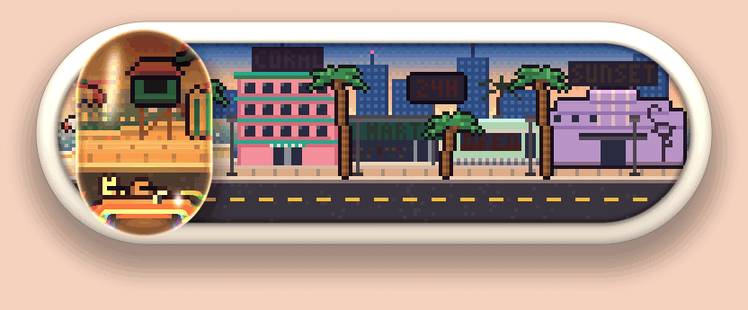
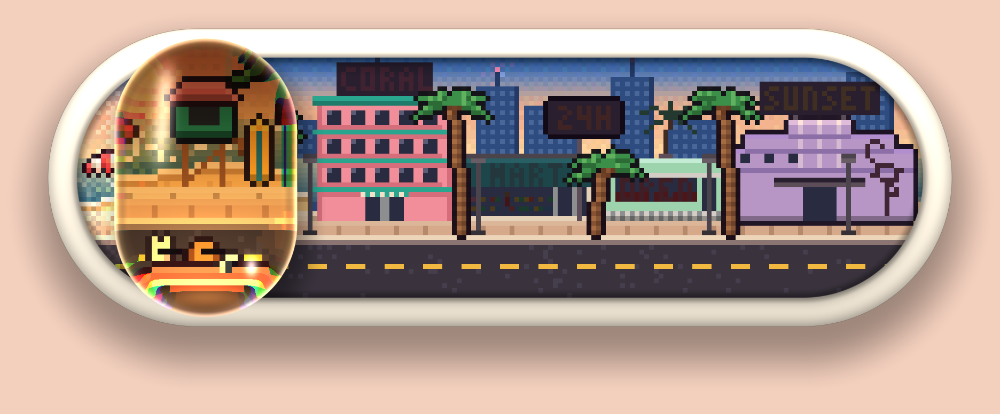
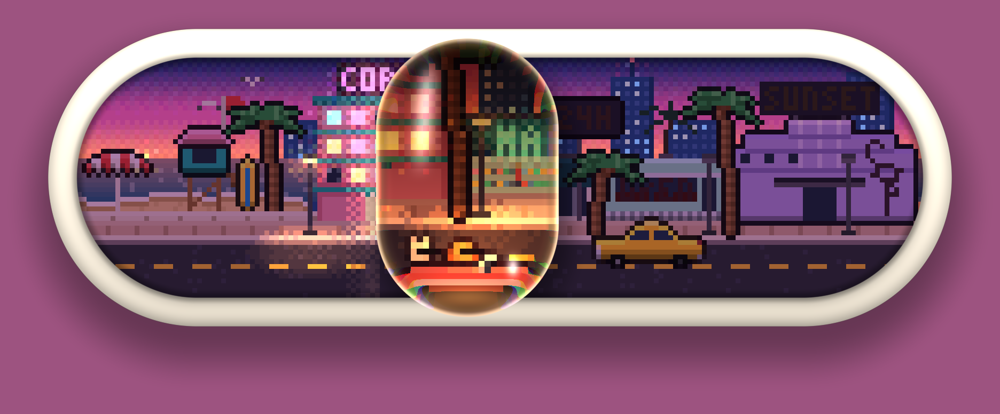
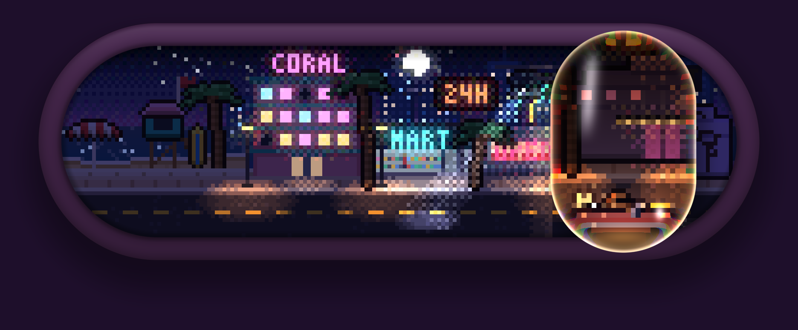
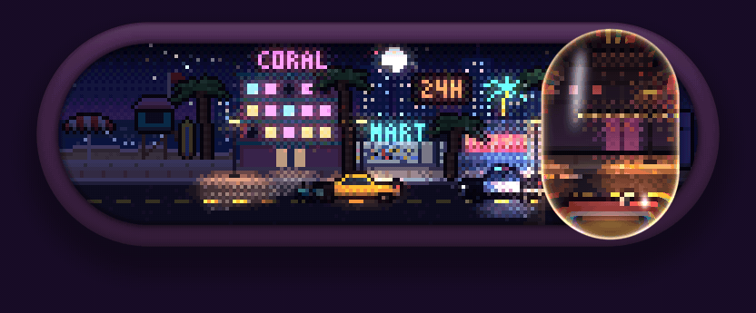
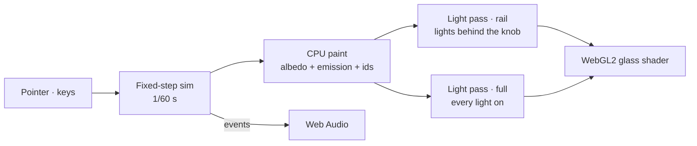

<div align="center">



<p>
  <a href="https://kutluhangil.github.io/NeonCoastSwitch/"></a>
  
  
  
</p>

<p><em>A big pill-shaped toggle switch with a 176 × 50 pixel-art coast town inside it.<br>
Slide the amber glass and the evening runs from golden hour to midnight. The street comes on behind it.</em></p>

<a href="https://kutluhangil.github.io/NeonCoastSwitch/"></a>

</div>


## The evening, in three frames

<table>
  <tr>
    <td width="33%"></td>
    <td width="33%"></td>
    <td width="33%"></td>
  </tr>
  <tr>
    <td align="center"><code>18:45</code> · golden hour</td>
    <td align="center"><code>20:45</code> · dusk</td>
    <td align="center"><code>23:09</code> · night</td>
  </tr>
</table>

Everything is drawn on the CPU into two pixel buffers, one for albedo and one for emission. Every shape is stamped as a sprite with an automatic dark outline, a lighter top row and a darker bottom row. Painting a pixel clears the glow behind it, so whatever stands in front hides the light. A single WebGL2 fragment shader then turns the result into the moulded bezel and the glass.


## What's in the town

| | |
|---|---|
| **The beach** | A banded sun sinking into the sea, glitter on the water, surf on the sand, a teal lifeguard tower with a pink roof and a red flag, a striped umbrella, a surfboard, a palm and a low sea wall. |
| **The boulevard** | Hotel **CORAL** with teal ledges, an all-night **MART** with a **24H** sign on a post, a mint-and-chrome diner with **OPEN** and a neon palm, and a lavender deco club with a **SUNSET** roof sign and a neon flamingo. Far blue towers blink behind them. |
| **The light** | Ambient light drifts from golden hour to dusk to night. Behind the knob, windows light up (warm, pink, cool, fluorescent in the store, some left dark), sodium lamps pool orange and every sign spills its colour, all with 4 × 4 Bayer-dithered edges. Neon flickers as it catches. Late at night the SUNSET letters chase on the beat. |
| **The convertible** | Coral, white stripe, chrome. A dog in sunglasses drives, ears flapping and tongue out at speed. A white cat rides in the back, her lenses glinting. Exhaust puffs, speed lines, brake lights, and tyre smoke with a squeal on hard reversals. |
| **Street life** | Sedans, coupes, vans and a yellow taxi drive left in the far lane. After dark, speeding brings a police car onto your tail. Slow down and it swings out, overtakes and leaves while the dog barks. A helicopter arrives at night and sweeps its searchlight. |


## The hold-up



Late at night, once the far lane is clear (or earlier, if you tap the store three times after dark), it plays out left of the knob. The store window shatters and the alarm flashes. Two masked figures in teal jackets run out with a sack and crouch behind a yellow muscle car. A police car slides to a stop and two officers crouch behind it. For about five seconds both sides fire from cover, with muzzle flashes lighting the street and sparks and glass flying off the car bodies. Then the robbers peel off left in tyre smoke and the police give chase under the helicopter's light. The dog and the cat duck down the whole time. It is stylised and bloodless; nobody is hit.


## Tap the scene

Every tap has its own synthesised sound, and hovering outlines what can be tapped.

| Tap | What happens |
|---|---|
| **The knob** (or <kbd>H</kbd>) | The convertible hops on its hydraulics (air hiss, clunk, squeaking springs) and honks |
| **The road** | The car drives to that spot |
| **A palm** | Fronds rustle and a coconut falls. If the car is underneath, the dog gets bonked: boing, a yelp, stars circling his head |
| **A hotel window** | Three knocks. The room lights up, a silhouette crosses, a muffled *"hey!"*, and a **!** pops up |
| **The store** | Door chime, the door slides open, the clerk waves |
| **The diner** | The order bell rings and a carhop rolls a milkshake out on skates. The dog slurps it, with floating hearts |
| **A neon sign** | It shorts out with sparks, crackles and a stuttering buzz |
| **The sea** | A dolphin leaps: splash, clicks, whistle |
| **The lifeguard tower** | A trilled whistle, and the flag flaps |
| **Traffic** | Each car honks back at its own pitch and flashes its lights |
| **The police** | Bullhorn yelp and radio chatter |
| **The helicopter** | Radio squelch, and the searchlight swings onto you |
| **The sky** | A shooting star with a chime at night; a gull flies in crying by day |

Leave the car alone for a few seconds and the dog drums on the door in time with the music while the cat bobs her head. After a while he leans on the horn and barks.


## The glass

One full-canvas WebGL2 fragment shader draws everything outside the pixel buffers:

- a moulded bezel, cream by day and dark plum at night, with a soft drop shadow;
- the scene, always sampled with nearest filtering, at whole device pixels per scene pixel;
- a capsule knob that magnifies a **fully lit** render (UV scale 0.78), sampled slightly low so the whole car shows. It has RGB-split refraction near the rim, a Fresnel edge, light focused at its foot, two highlights and an amber aviator tint that darkens toward the top.

The knob follows your finger on a spring, stretches with speed and wobbles when it stops.




## The sound

The music is an original four-bar eighties synth-pop song in A minor (Am · F · C · G) at 100 BPM, synthesised live and kept about 5 dB under the effects. It runs through a compressor, a reverb and a dotted-eighth echo. The layers come in as the knob moves:

| Knob | Layer |
|---|---|
| always | The coast: surf swells, gulls by day, a city hum at night |
| early | A pumping detuned-saw pad and a filtered square arpeggio |
| middle | Gated snare, short kick, hats and an octave saw bass |
| late | A detuned lead with glide and late vibrato |
| midnight | FM bells, toms and a crash |

During a chase or the hold-up the bass doubles to sixteenths and chord stabs push the song along. Effects include the engine climbing through its gears, tyre squeals, a two-tone horn, neon crackling on, lamps ticking on, passing cars panned with a Doppler drop, a wail/yelp siren, the helicopter's blade slap, the store alarm, breaking glass, gunshots echoing off the buildings (the music ducks under them), ricochets, the getaway roar, the dog's yips and the cat's indignant meow.


## Controls

| Input | Effect |
|---|---|
| Drag the knob | Moves the evening from `18:30` to `23:30`; the convertible follows |
| <kbd>←</kbd> <kbd>→</kbd> <kbd>PgUp</kbd> <kbd>PgDn</kbd> <kbd>Home</kbd> <kbd>End</kbd> | Move the knob (`role="slider"`) |
| <kbd>Enter</kbd> / <kbd>Space</kbd> | Send it to the far end with a double honk |
| <kbd>H</kbd> | Hop and honk |
| **Sound on / off** | Audio starts with the first touch |

The readouts show the clock, the speed in mph, and a status: *Cruising, Speeding, Pursuit, Lost them, Alarm, Shots fired, Getaway*. The page colours follow the evening from peach to a deep night purple.


## Türkçe özet

**Neon Coast Switch**, içinde 176 × 50 piksellik bir sahil kasabası olan büyük, hap şeklinde bir aç-kapa düğmesi. Cam düğmeyi kaydırdıkça akşam altın saatten gece yarısına ilerliyor; pencereler, sokak lambaları ve neon tabelalar düğmenin arkasında yanıyor. Güneş gözlüklü bir köpeğin sürdüğü üstü açık araba, trafik, polis kovalamacası ve gece yarısı bir soygun sahnesi var. Sahnenin her yerine dokunulabiliyor ve her dokunuşun kendi sentezlenmiş sesi var. Tek bir WebGL2 shader, tüm sesler Web Audio ile sentezleniyor, hiçbir kütüphane yok.


## Development

`index.html` is the whole piece: a single self-contained file. The source lives in `src/` as plain scripts, and `scripts/build.mjs` concatenates them into that file. There is no bundler, no minifier and no runtime dependency.

```sh
npm install                 # Playwright, used only by the check scripts
npm run build               # src/ → index.html
npm test                    # build + logic tests (node:test)
npm run shot                # headless screenshots into shots/
node scripts/audio-check.mjs    # every effect plays; music ≈ 5 dB under effects
node scripts/perf.mjs           # CPU time per frame
node scripts/readme-media.mjs   # re-record the GIFs and stills in docs/media/
node scripts/readme-hero.mjs    # regenerate the animated banner
```

The check scripts look for Chrome for Testing in the Playwright cache. Open `index.html?debug` to get `window.NCS` (seek, step, freeze, tap, raw frame dumps).

```
src/
  core/    util, layout constants, world (state, fixed-step sim, lights)
  gfx/     pixel buffers, 3×5 font, light pass, glass shader
  scene/   sky, beach, city, street, neon
  actors/  convertible, traffic, police, helicopter, hold-up, taps, idle, particles
  audio/   graph and helpers, music, effects, ambience
  ui/      pointer and keyboard, readouts and page colours
  main.js  boot and frame loop
docs/      plan and README media
```

<div align="center">
<br>
<a href="https://github.com/kutluhangil"></a>
<sub>Material Studies · No. 066 · everything original: invented names, no real brands, no samples.</sub>
</div>
